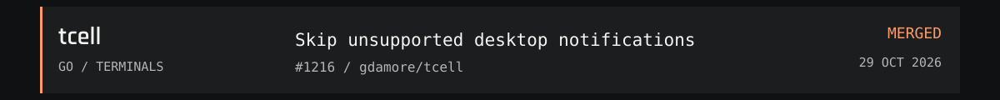
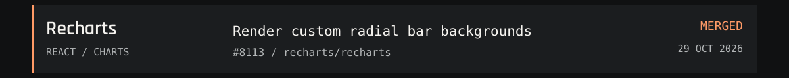
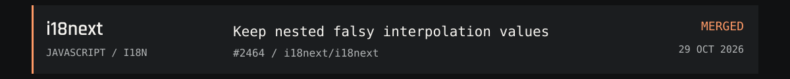
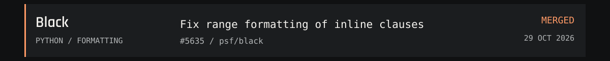

<picture>
  <source media="(prefers-reduced-motion: reduce) and (max-width: 600px)" srcset="./assets/hero-mobile-static.svg">
  <source media="(prefers-reduced-motion: reduce)" srcset="./assets/hero-static.svg">
  <source media="(max-width: 600px)" srcset="./assets/hero-mobile.svg">
  
</picture>

I'm Batman21, an indie developer working across languages and tools. I build useful open-source software, fix the rough edges, and share what I learn.

Part of team NewKing, a small crew of indie developers who also queue League of Legends.

<picture>
  <source media="(prefers-reduced-motion: reduce) and (max-width: 600px)" srcset="./assets/contributions-mobile-static.svg">
  <source media="(prefers-reduced-motion: reduce)" srcset="./assets/contributions-static.svg">
  <source media="(max-width: 600px)" srcset="./assets/contributions-mobile.svg">
  
</picture>

Public PRs to repos not owned by this account. All-time snapshot: <strong>2026-10-29</strong>. Repo count includes merged work.

### A few things I've helped improve

<a href="https://github.com/gdamore/tcell/pull/1216">
<picture>
  <source media="(prefers-reduced-motion: reduce) and (max-width: 600px)" srcset="./assets/pr-tcell-mobile-static.svg">
  <source media="(prefers-reduced-motion: reduce)" srcset="./assets/pr-tcell-static.svg">
  <source media="(max-width: 600px)" srcset="./assets/pr-tcell-mobile.svg">
  
</picture>
</a>

<a href="https://github.com/recharts/recharts/pull/8113">
<picture>
  <source media="(prefers-reduced-motion: reduce) and (max-width: 600px)" srcset="./assets/pr-recharts-mobile-static.svg">
  <source media="(prefers-reduced-motion: reduce)" srcset="./assets/pr-recharts-static.svg">
  <source media="(max-width: 600px)" srcset="./assets/pr-recharts-mobile.svg">
  
</picture>
</a>

<a href="https://github.com/i18next/i18next/pull/2464">
<picture>
  <source media="(prefers-reduced-motion: reduce) and (max-width: 600px)" srcset="./assets/pr-i18next-mobile-static.svg">
  <source media="(prefers-reduced-motion: reduce)" srcset="./assets/pr-i18next-static.svg">
  <source media="(max-width: 600px)" srcset="./assets/pr-i18next-mobile.svg">
  
</picture>
</a>

<a href="https://github.com/psf/black/pull/5635">
<picture>
  <source media="(prefers-reduced-motion: reduce) and (max-width: 600px)" srcset="./assets/pr-black-mobile-static.svg">
  <source media="(prefers-reduced-motion: reduce)" srcset="./assets/pr-black-static.svg">
  <source media="(max-width: 600px)" srcset="./assets/pr-black-mobile.svg">
  
</picture>
</a>

[All merged contributions](https://github.com/search?q=is%3Apr+author%3Ank-batman21+is%3Amerged+is%3Apublic+-user%3Ank-batman21&type=pullrequests) · [Open proposals](https://github.com/search?q=is%3Apr+author%3Ank-batman21+is%3Aopen+is%3Apublic+-user%3Ank-batman21&type=pullrequests)

<picture>
  <source media="(prefers-reduced-motion: reduce) and (max-width: 600px)" srcset="./assets/toolbox-mobile-static.svg">
  <source media="(prefers-reduced-motion: reduce)" srcset="./assets/toolbox-static.svg">
  <source media="(max-width: 600px)" srcset="./assets/toolbox-mobile.svg">
  
</picture>

<picture>
  <source media="(prefers-reduced-motion: reduce) and (max-width: 600px)" srcset="./assets/process-mobile-static.svg">
  <source media="(prefers-reduced-motion: reduce)" srcset="./assets/process-static.svg">
  <source media="(max-width: 600px)" srcset="./assets/process-mobile.svg">
  
</picture>

<picture>
  <source media="(prefers-reduced-motion: reduce) and (max-width: 600px)" srcset="./assets/footer-mobile-static.svg">
  <source media="(prefers-reduced-motion: reduce)" srcset="./assets/footer-static.svg">
  <source media="(max-width: 600px)" srcset="./assets/footer-mobile.svg">
  
</picture>
